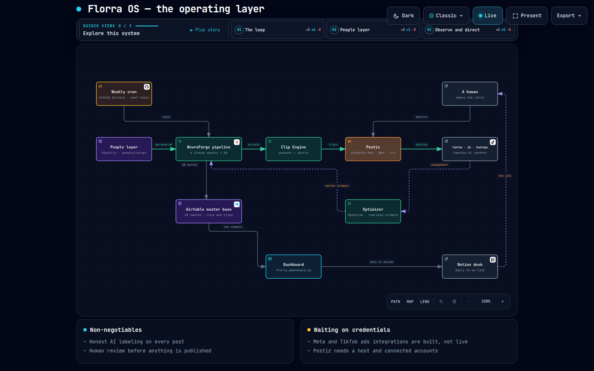

# Maps

Verified system maps of Florra OS, built with Archify (`/archify` in Claude
Code, vendored at `.claude/skills/archify/`). The JSON is the source of truth;
the HTML is a self-contained interactive viewer you can open, present, and
export as PNG, SVG, WebM, or a 1200×630 share card.

| Map | Source | Open |
|-----|--------|------|
| Florra OS — the operating layer | `florra-os.architecture.json` | `florra-os.architecture.html` |



Guided views inside the map: **The loop** (generate → publish → learn →
scale), **People layer** (Distilly → pipeline), **Observe and direct**
(Airtable → dashboard → desk → a human).

## Editing

Ask `/archify` to change the map ("add HeyGen between the pipeline and the
clip engine"), or edit the JSON by hand and re-deliver:

```bash
cd .claude/skills/archify && export ARCHIFY_UPDATE_CHECK_DISABLED=1
node bin/archify.mjs deliver architecture ../../../docs/maps/florra-os.architecture.json \
  ../../../docs/maps/florra-os.architecture.html --quality showcase --json
```

`florra-os.architecture.visual-check.json` is the last acceptance receipt.
Regenerate the preview with `visual-check` (needs Chromium via `ARCHIFY_CHROME`).

Rule for every map: show what is live as live and what is built-but-waiting as
waiting. The cards at the bottom carry that status.
